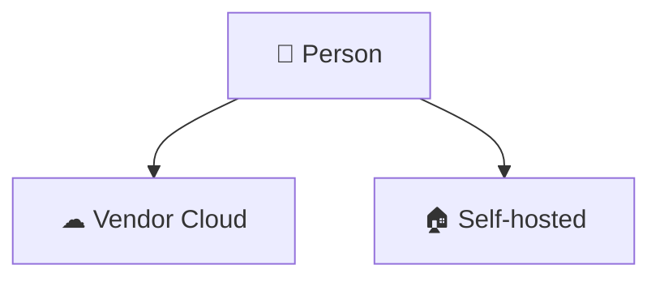

# Awesome-Personal-Agents

[](https://0xWelt.github.io/Awesome-Personal-Agents/)
[](https://github.com/0xWelt/Awesome-Personal-Agents)
[](https://github.com/0xWelt/Awesome-Personal-Agents/fork)
[](https://creativecommons.org/licenses/by/4.0/)
[](https://awesome.re)

A curated list of named personal AI agents, grouped by who provides the persistent runtime.

This list includes two kinds of named personal agent. One is a vendor product whose persistent runtime the vendor provides, including a cloud computer and a desktop app, such as Grok Bot, Dots, or Claude Duet. The other is a self-hosted, always-on agent you run yourself, such as OpenClaw or Hermes Agent, where the persistent runtime is your machine plus a gateway or service. Either way it needs connectors or tools, background work, and some approval or policy control. A general chat assistant is not an entry, even when it has tools, connectors, computer use, or a cowork mode — so ChatGPT, Claude, Gemini, and Microsoft Copilot are not listed in place of the company's agent product. Coding harnesses and Lovable-like vibe-coding web builders (Bolt.new, Replit, Open Lovable, Firebase Studio, and similar) are listed in [Awesome-Vibe-Coding](https://github.com/0xWelt/Awesome-Vibe-Coding). Supporting tools and services — including infrastructure platforms (AWS, Vercel, Docker, GitHub and their official CLIs) and code-related MCP servers, skills, and CLIs — are listed in [Awesome-Agent-Services](https://github.com/0xWelt/Awesome-Agent-Services).

🌐 **Live Website**: [https://0xWelt.github.io/Awesome-Personal-Agents/](https://0xWelt.github.io/Awesome-Personal-Agents/)

> **Content structure**: tools are organized in the [`contents/`](contents/) directory — one
> markdown file per tool, grouped by category, with `_meta.md`
> files describing each folder. The live website is generated from these files
> by `yaal/scripts/parse-readme.js`.

## Architecture

Named personal agents in this list are grouped by who provides the persistent runtime.



## Categories

| Category | Description | Location |
| --- | --- | --- |
| Vendor Cloud | Named personal-agent products whose persistent runtime is provided by the vendor. This includes desktop apps and separately named products. | [contents/vendor-cloud/](contents/vendor-cloud/) |
| Self-hosted | Named personal agents you run yourself on a machine or gateway you control. | [contents/self-hosted/](contents/self-hosted/) |

## Adding a Tool

To add a tool, create a markdown file in the matching `contents/` folder:

```markdown
---
name: Tool Name
link: https://example.com
---

Short description of the tool.
```

Required frontmatter is `name` and `link`. Optional `tags` are short labels such as `desktop`, `web`, `mobile`, `connectors`, `computer-use`, `skills`, `routines`, or `legal`. Do not add a `command` field. Use the canonical product URL, without UTM, referral, or affiliate parameters.

Include a product only when it is a named personal agent that can act over time, with a persistent runtime (a vendor cloud computer, or your machine plus a gateway or service), connectors or tools, background or unattended work, and some approval or policy control. That covers vendor cloud agents and self-hosted agents such as OpenClaw and Hermes Agent. Do not add ChatGPT, Claude, Gemini, or Microsoft Copilot as stand-ins for that company's agent. Do not add Claude Code, Codex, or Gemini CLI; those belong in Awesome-Vibe-Coding.

Put a vendor-cloud product in [`contents/vendor-cloud/`](contents/vendor-cloud/) and a self-hosted agent in [`contents/self-hosted/`](contents/self-hosted/). A named agent reached inside a host app is still its own entry. Mention other modes in the body. The tool is picked up automatically when the website builds. Prefer adding a separate file over editing an existing one — it keeps PRs small and conflict-free.

## Repo Status


## Contributors

This project exists thanks to all the people who contribute.

<a href="https://github.com/0xWelt/Awesome-Personal-Agents/graphs/contributors">
  
</a>

## Star History

[](https://star-history.com/#0xWelt/Awesome-Personal-Agents&Date)

## License

[](https://creativecommons.org/licenses/by/4.0/)

This work is licensed under a
[Creative Commons Attribution 4.0 International License](http://creativecommons.org/licenses/by/4.0/).
