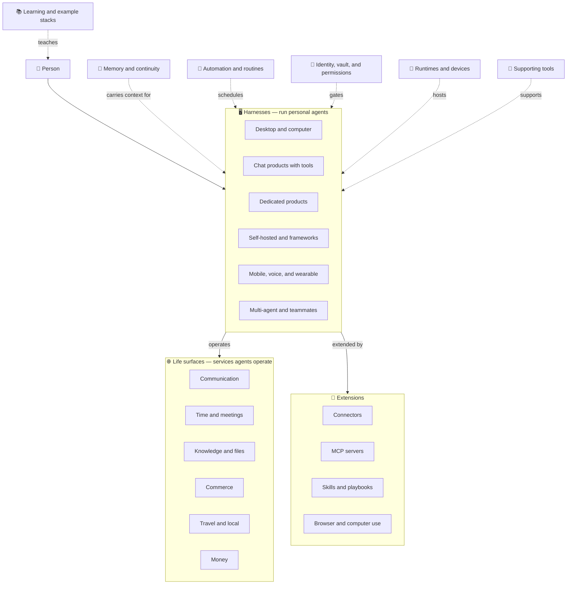

# Awesome-Personal-Agents

[](https://0xWelt.github.io/Awesome-Personal-Agents/)
[](https://github.com/0xWelt/Awesome-Personal-Agents)
[](https://github.com/0xWelt/Awesome-Personal-Agents/fork)
[](https://creativecommons.org/licenses/by/4.0/)
[](https://awesome.re)

A curated list of named personal AI agents and the tool stacks they use to act on a person's life and work.

This list is for a named personal agent that can act on a person's behalf over time: its own computer or persistent runtime, connectors or apps, background work, and approval for sensitive actions. Examples are Grok Bot, Dots, and Claude Duet. A general chat assistant is not an entry, even when it has tools, connectors, computer use, or a cowork mode — so ChatGPT, Claude, Gemini, and Microsoft Copilot are not listed in place of the company's agent product. Coding-agent stacks (terminal harnesses, coding IDEs, and coding-oriented MCP servers and skills) are listed in [Awesome-Vibe-Coding](https://github.com/0xWelt/Awesome-Vibe-Coding).

🌐 **Live Website**: [https://0xWelt.github.io/Awesome-Personal-Agents/](https://0xWelt.github.io/Awesome-Personal-Agents/)

> **Content structure**: tools are organized in the [`contents/`](contents/) directory — one
> markdown file per tool, grouped by category and subcategory, with `_meta.md`
> files describing each folder. The live website is generated from these files
> by `yaal/scripts/parse-readme.js`.

## Architecture

A personal agent sits between a person and the services that make up their life and work. Harnesses run the agent. Life surfaces are what it operates. Extensions plug in. Memory, routines, identity, runtimes, and supporting tools sit alongside.



## Categories

| Category | Description | Location |
| --- | --- | --- |
| Harnesses | Named personal agents you run — desktop and computer agents, dedicated agent products, self-hosted frameworks, mobile and voice, and multi-agent teams. Not general chat assistants. | [contents/harnesses/](contents/harnesses/) |
| Life Surfaces | Services an agent operates for a person — communication, time, files, commerce, travel, and money. | [contents/life-surfaces/](contents/life-surfaces/) |
| Extensions | What plugs into a harness — connectors, MCP servers, skills and playbooks, and browser or computer use. | [contents/extensions/](contents/extensions/) |
| Memory and Continuity | How an agent keeps context across sessions. | [contents/memory-and-continuity/](contents/memory-and-continuity/) |
| Automation and Routines | Schedules, routines, and triggers that run an agent without starting from a blank chat. | [contents/automation-and-routines/](contents/automation-and-routines/) |
| Identity, Vault, and Permissions | Credentials, vaults, and permission models that bound what an agent may do. | [contents/identity-vault-permissions/](contents/identity-vault-permissions/) |
| Runtimes and Devices | Phones, desktops, browsers, and cloud computers an agent executes on, when they are infrastructure rather than the agent product. | [contents/runtimes-and-devices/](contents/runtimes-and-devices/) |
| Supporting Tools | Observability, safety, and spend tooling around a personal agent. | [contents/supporting-tools/](contents/supporting-tools/) |
| Learning and Example Stacks | Guides and example setups for using a personal agent day to day. | [contents/learning-and-example-stacks/](contents/learning-and-example-stacks/) |

## Adding a Tool

To add a tool, create a markdown file in the matching `contents/` folder:

```markdown
---
name: Tool Name
link: https://example.com
---

Short description of the tool.
```

Required frontmatter is `name` and `link`. Optional `tags` are short labels such as `desktop`, `web`, `mobile`, `connectors`, `computer-use`, `skills`, or `routines`. Do not add a `command` field. Use the canonical product URL, without UTM, referral, or affiliate parameters.

Include a product only when it is a named personal agent with its own computer or persistent runtime, connectors or apps, background work, and approval for sensitive actions. Do not add ChatGPT, Claude, Gemini, or Microsoft Copilot as stand-ins for that company's agent. Do not add Claude Code, Gemini CLI, or GitHub Copilot; those belong in Awesome-Vibe-Coding.

Put each product in the one subcategory that best matches how people launch that product. A named agent reached inside a host app is still its own entry. Mention other modes in the body. The tool is picked up automatically when the website builds. Prefer adding a separate file over editing an existing one — it keeps PRs small and conflict-free.

## Contributors

This project exists thanks to all the people who contribute.

<a href="https://github.com/0xWelt/Awesome-Personal-Agents/graphs/contributors">
  
</a>

## Star History

[](https://star-history.com/#0xWelt/Awesome-Personal-Agents&Date)

## License

[](https://creativecommons.org/licenses/by/4.0/)

This work is licensed under a
[Creative Commons Attribution 4.0 International License](http://creativecommons.org/licenses/by/4.0/).
